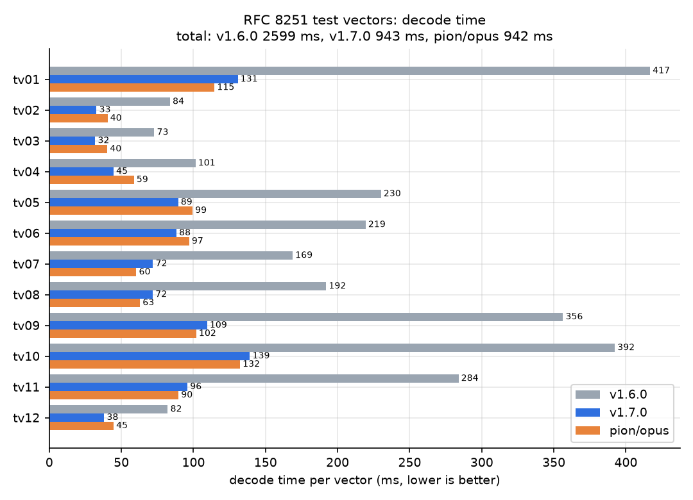
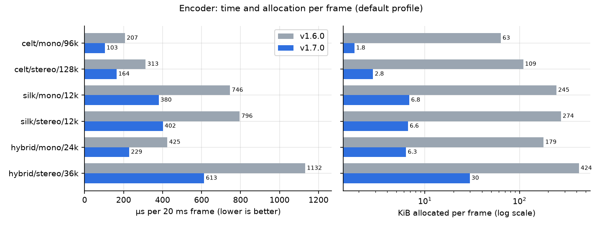
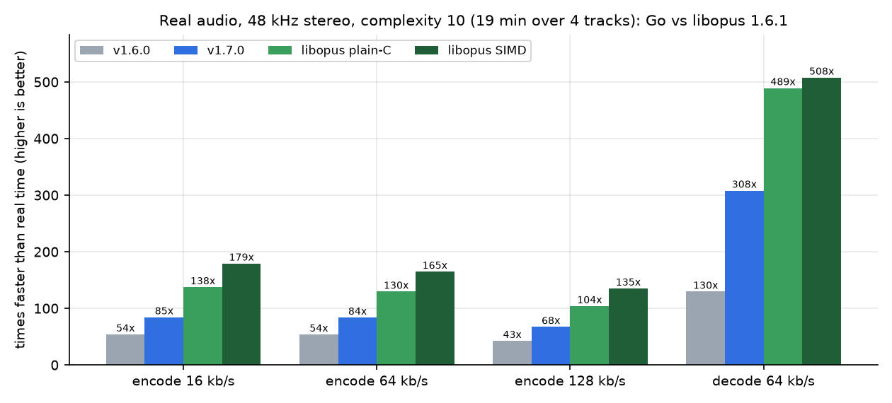

# Performance Baseline

Last measured: 2026-07-18

This baseline records the Phase 3-1 public benchmark harness. Future Phase 3
optimization iterations should compare against this file with `benchstat` or an
equivalent before/after benchmark table. A claimed performance win needs at
least 5% improvement in time or allocations and must preserve packet bytes or
decoded PCM for representative inputs.

## Benchmark Harness

Command:

```text
go test -run '^$' -bench '^BenchmarkPerf/' -benchtime=200ms -count=5 -benchmem .
```

Short smoke command:

```text
go test -run '^$' -bench '^BenchmarkPerf/' -benchtime=1x -benchmem .
```

Environment:

```text
goos: windows
goarch: amd64
Go: go1.26.5 windows/amd64
OS: Microsoft Windows 11 Home 10.0.22631
CPU: 11th Gen Intel(R) Core(TM) i7-11700 @ 2.50GHz
logical CPUs: 16
package: github.com/darui3018823/opus
source base before Phase 3-1 commit: b0044dd
```

Workloads:

| Workload | Encoder setup | Signal |
|---|---|---|
| `celt/mono/48k/20ms` | `ApplicationAudio`, 96 kbps, `SignalMusic` | broadband music-like harmonic frame |
| `celt/stereo/48k/20ms` | `ApplicationAudio`, 128 kbps, `SignalMusic` | broadband music-like harmonic frame |
| `silk/mono/48k/20ms` | `ApplicationVOIP`, 24 kbps, `SignalVoice` | deterministic speech-like frame |
| `silk/stereo/48k/20ms` | `ApplicationVOIP`, 36 kbps, `SignalVoice` | deterministic speech-like frame |
| `hybrid/mono/48k/20ms` | `ApplicationVOIP`, 64 kbps, `SignalVoice` | speech-like frame plus high-band tone |
| `hybrid/stereo/48k/20ms` | `ApplicationVOIP`, 96 kbps, `SignalVoice` | speech-like frame plus high-band tone |

Each benchmark validates the generated packet's TOC mode and 20 ms duration
before timing starts. Since v1.5.0 made `ModePolicyLibopus` the default, the
harness pins `ModePolicyLegacy` so that the workloads keep their modes and
these numbers stay comparable; `BenchmarkPerfVsLibopus` below times both
policies.

## Median Results

Medians from five runs:

| Benchmark | ns/op | B/op | allocs/op |
|---|---:|---:|---:|
| `BenchmarkPerf/encode/celt/mono/48k/20ms-16` | 374810 | 182730 | 245 |
| `BenchmarkPerf/decode/celt/mono/48k/20ms-16` | 226426 | 114833 | 123 |
| `BenchmarkPerf/encode/celt/stereo/48k/20ms-16` | 463695 | 277111 | 352 |
| `BenchmarkPerf/decode/celt/stereo/48k/20ms-16` | 356998 | 213512 | 166 |
| `BenchmarkPerf/encode/silk/mono/48k/20ms-16` | 5594485 | 683858 | 8407 |
| `BenchmarkPerf/decode/silk/mono/48k/20ms-16` | 56689 | 44940 | 51 |
| `BenchmarkPerf/encode/silk/stereo/48k/20ms-16` | 20143800 | 5095172 | 14060 |
| `BenchmarkPerf/decode/silk/stereo/48k/20ms-16` | 116918 | 98306 | 89 |
| `BenchmarkPerf/encode/hybrid/mono/48k/20ms-16` | 3544840 | 670307 | 4517 |
| `BenchmarkPerf/decode/hybrid/mono/48k/20ms-16` | 195856 | 139174 | 94 |
| `BenchmarkPerf/encode/hybrid/stereo/48k/20ms-16` | 12391829 | 3226950 | 10867 |
| `BenchmarkPerf/decode/hybrid/stereo/48k/20ms-16` | 351388 | 276985 | 148 |

## Raw Output

```text
goos: windows
goarch: amd64
pkg: github.com/darui3018823/opus
cpu: 11th Gen Intel(R) Core(TM) i7-11700 @ 2.50GHz
BenchmarkPerf/encode/celt/mono/48k/20ms-16         	     614	    553286 ns/op	  182741 B/op	     245 allocs/op
BenchmarkPerf/encode/celt/mono/48k/20ms-16         	     644	    383187 ns/op	  182726 B/op	     245 allocs/op
BenchmarkPerf/encode/celt/mono/48k/20ms-16         	     618	    374810 ns/op	  182742 B/op	     245 allocs/op
BenchmarkPerf/encode/celt/mono/48k/20ms-16         	     724	    340323 ns/op	  182730 B/op	     245 allocs/op
BenchmarkPerf/encode/celt/mono/48k/20ms-16         	     778	    349270 ns/op	  182728 B/op	     245 allocs/op
BenchmarkPerf/decode/celt/mono/48k/20ms-16         	     996	    257095 ns/op	  114833 B/op	     123 allocs/op
BenchmarkPerf/decode/celt/mono/48k/20ms-16         	    1102	    241880 ns/op	  114840 B/op	     123 allocs/op
BenchmarkPerf/decode/celt/mono/48k/20ms-16         	    1104	    226426 ns/op	  114838 B/op	     123 allocs/op
BenchmarkPerf/decode/celt/mono/48k/20ms-16         	    1135	    219945 ns/op	  114830 B/op	     123 allocs/op
BenchmarkPerf/decode/celt/mono/48k/20ms-16         	    1140	    216153 ns/op	  114825 B/op	     123 allocs/op
BenchmarkPerf/encode/celt/stereo/48k/20ms-16       	     505	    458229 ns/op	  277111 B/op	     352 allocs/op
BenchmarkPerf/encode/celt/stereo/48k/20ms-16       	     518	    492906 ns/op	  277090 B/op	     352 allocs/op
BenchmarkPerf/encode/celt/stereo/48k/20ms-16       	     494	    463695 ns/op	  277122 B/op	     352 allocs/op
BenchmarkPerf/encode/celt/stereo/48k/20ms-16       	     544	    471085 ns/op	  277125 B/op	     352 allocs/op
BenchmarkPerf/encode/celt/stereo/48k/20ms-16       	     505	    440483 ns/op	  277111 B/op	     352 allocs/op
BenchmarkPerf/decode/celt/stereo/48k/20ms-16       	     744	    328846 ns/op	  213531 B/op	     166 allocs/op
BenchmarkPerf/decode/celt/stereo/48k/20ms-16       	     652	    370454 ns/op	  213562 B/op	     166 allocs/op
BenchmarkPerf/decode/celt/stereo/48k/20ms-16       	     698	    356998 ns/op	  213505 B/op	     166 allocs/op
BenchmarkPerf/decode/celt/stereo/48k/20ms-16       	     631	    342089 ns/op	  213512 B/op	     166 allocs/op
BenchmarkPerf/decode/celt/stereo/48k/20ms-16       	     704	    391441 ns/op	  213496 B/op	     166 allocs/op
BenchmarkPerf/encode/silk/mono/48k/20ms-16         	      38	   5684339 ns/op	  683858 B/op	    8407 allocs/op
BenchmarkPerf/encode/silk/mono/48k/20ms-16         	      40	   5493475 ns/op	  688078 B/op	    8464 allocs/op
BenchmarkPerf/encode/silk/mono/48k/20ms-16         	      40	   5594485 ns/op	  688083 B/op	    8464 allocs/op
BenchmarkPerf/encode/silk/mono/48k/20ms-16         	      36	   5558683 ns/op	  678934 B/op	    8339 allocs/op
BenchmarkPerf/encode/silk/mono/48k/20ms-16         	      38	   6116232 ns/op	  683858 B/op	    8407 allocs/op
BenchmarkPerf/decode/silk/mono/48k/20ms-16         	    3945	     58577 ns/op	   44939 B/op	      51 allocs/op
BenchmarkPerf/decode/silk/mono/48k/20ms-16         	    4537	     54145 ns/op	   44940 B/op	      51 allocs/op
BenchmarkPerf/decode/silk/mono/48k/20ms-16         	    4650	     51409 ns/op	   44939 B/op	      51 allocs/op
BenchmarkPerf/decode/silk/mono/48k/20ms-16         	    3976	     57954 ns/op	   44940 B/op	      51 allocs/op
BenchmarkPerf/decode/silk/mono/48k/20ms-16         	    3714	     56689 ns/op	   44940 B/op	      51 allocs/op
BenchmarkPerf/encode/silk/stereo/48k/20ms-16       	      22	  19619423 ns/op	 5095172 B/op	   14060 allocs/op
BenchmarkPerf/encode/silk/stereo/48k/20ms-16       	      25	  20365804 ns/op	 5178321 B/op	   14318 allocs/op
BenchmarkPerf/encode/silk/stereo/48k/20ms-16       	      19	  20143800 ns/op	 4988754 B/op	   13749 allocs/op
BenchmarkPerf/encode/silk/stereo/48k/20ms-16       	      22	  21526895 ns/op	 5095155 B/op	   14060 allocs/op
BenchmarkPerf/encode/silk/stereo/48k/20ms-16       	      22	  19513936 ns/op	 5095150 B/op	   14060 allocs/op
BenchmarkPerf/decode/silk/stereo/48k/20ms-16       	    2258	    126948 ns/op	   98305 B/op	      89 allocs/op
BenchmarkPerf/decode/silk/stereo/48k/20ms-16       	    2328	    116918 ns/op	   98306 B/op	      89 allocs/op
BenchmarkPerf/decode/silk/stereo/48k/20ms-16       	    2074	    125415 ns/op	   98307 B/op	      89 allocs/op
BenchmarkPerf/decode/silk/stereo/48k/20ms-16       	    2149	    106664 ns/op	   98308 B/op	      89 allocs/op
BenchmarkPerf/decode/silk/stereo/48k/20ms-16       	    2185	    104203 ns/op	   98305 B/op	      89 allocs/op
BenchmarkPerf/encode/hybrid/mono/48k/20ms-16       	      69	   3533735 ns/op	  674826 B/op	    4577 allocs/op
BenchmarkPerf/encode/hybrid/mono/48k/20ms-16       	      58	   3507891 ns/op	  668613 B/op	    4494 allocs/op
BenchmarkPerf/encode/hybrid/mono/48k/20ms-16       	      58	   3716669 ns/op	  668613 B/op	    4494 allocs/op
BenchmarkPerf/encode/hybrid/mono/48k/20ms-16       	      64	   3630075 ns/op	  672635 B/op	    4549 allocs/op
BenchmarkPerf/encode/hybrid/mono/48k/20ms-16       	      60	   3544840 ns/op	  670307 B/op	    4517 allocs/op
BenchmarkPerf/decode/hybrid/mono/48k/20ms-16       	    1303	    198104 ns/op	  139174 B/op	      94 allocs/op
BenchmarkPerf/decode/hybrid/mono/48k/20ms-16       	    1386	    167967 ns/op	  139167 B/op	      94 allocs/op
BenchmarkPerf/decode/hybrid/mono/48k/20ms-16       	    1461	    172437 ns/op	  139163 B/op	      94 allocs/op
BenchmarkPerf/decode/hybrid/mono/48k/20ms-16       	    1302	    195856 ns/op	  139175 B/op	      94 allocs/op
BenchmarkPerf/decode/hybrid/mono/48k/20ms-16       	    1411	    208802 ns/op	  139177 B/op	      94 allocs/op
BenchmarkPerf/encode/hybrid/stereo/48k/20ms-16     	      21	  12814533 ns/op	 3226950 B/op	   10867 allocs/op
BenchmarkPerf/encode/hybrid/stereo/48k/20ms-16     	      21	  12181419 ns/op	 3226946 B/op	   10867 allocs/op
BenchmarkPerf/encode/hybrid/stereo/48k/20ms-16     	      21	  12391829 ns/op	 3226952 B/op	   10867 allocs/op
BenchmarkPerf/encode/hybrid/stereo/48k/20ms-16     	      22	  12395818 ns/op	 3211733 B/op	   10795 allocs/op
BenchmarkPerf/encode/hybrid/stereo/48k/20ms-16     	      21	  12138771 ns/op	 3226952 B/op	   10867 allocs/op
BenchmarkPerf/decode/hybrid/stereo/48k/20ms-16     	     714	    408285 ns/op	  276990 B/op	     148 allocs/op
BenchmarkPerf/decode/hybrid/stereo/48k/20ms-16     	     727	    316587 ns/op	  276971 B/op	     148 allocs/op
BenchmarkPerf/decode/hybrid/stereo/48k/20ms-16     	     656	    371267 ns/op	  276985 B/op	     148 allocs/op
BenchmarkPerf/decode/hybrid/stereo/48k/20ms-16     	     733	    351388 ns/op	  276965 B/op	     148 allocs/op
BenchmarkPerf/decode/hybrid/stereo/48k/20ms-16     	     646	    322342 ns/op	  276993 B/op	     148 allocs/op
PASS
ok  	github.com/darui3018823/opus	69.906s
```

## Phase 3-2 Comparison: NSQ Restore Buffer Reuse

Change: `restoreFrameState` now restores saved SILK NSQ history into existing
encoder buffers when possible, while `snapshotFrameState` remains a deep copy.

Command:

```text
go test -run '^$' -bench '^BenchmarkPerf/' -benchtime=200ms -count=5 -benchmem .
```

Median comparison:

| Benchmark | Baseline ns/op | New ns/op | Time | Baseline B/op | New B/op | Allocation |
|---|---:|---:|---:|---:|---:|---:|
| `BenchmarkPerf/encode/silk/mono/48k/20ms-16` | 5594485 | 5118559 | -8.5% | 683858 | 686536 | +0.4% |
| `BenchmarkPerf/encode/silk/stereo/48k/20ms-16` | 20143800 | 18465131 | -8.3% | 5095172 | 4663431 | -8.4% |
| `BenchmarkPerf/encode/hybrid/mono/48k/20ms-16` | 3544840 | 3413251 | -3.7% | 670307 | 657077 | -2.0% |
| `BenchmarkPerf/encode/hybrid/stereo/48k/20ms-16` | 12391829 | 12004582 | -3.1% | 3226950 | 2962475 | -8.2% |

The change is confined to SILK encoder speculative state rollback, so CELT-only
and decode workloads are outside the expected effect surface.

## Phase 3-3 Comparison: Noise-Shape Scratch Reuse

Change: `analyzeNoiseShapeFLP` now reuses per-subframe scratch slices within
one analysis call for windowing, autocorrelation, Schur reflection
coefficients, and AR coefficients.

The parent commit `aef1481` was measured in a detached temporary worktree with
the same command used for the new result:

```text
go test -run '^$' -bench '^BenchmarkPerf/encode/(silk|hybrid)/stereo/48k/20ms$' -benchtime=1s -count=5 -benchmem .
```

Median comparison against parent `aef1481`:

| Benchmark | Parent ns/op | New ns/op | Time | Parent B/op | New B/op | Allocation |
|---|---:|---:|---:|---:|---:|---:|
| `BenchmarkPerf/encode/silk/stereo/48k/20ms-16` | 21135259 | 20171730 | -4.6% | 4766144 | 3156567 | -33.8% |
| `BenchmarkPerf/encode/hybrid/stereo/48k/20ms-16` | 13511848 | 13134365 | -2.8% | 2978435 | 2262515 | -24.1% |

## Phase 3-4 Comparison: Noise-Shape Input Buffer Reuse

Change: `noiseShapeAnalysisBuffer` now reuses an internal SILK encoder scratch
buffer across analysis calls and explicitly clears the prefix that was
previously zero-filled by `make`.

The parent commit `7f0456f` was measured in a detached temporary worktree with
the same command used for the new result:

```text
go test -run '^$' -bench '^BenchmarkPerf/encode/(silk|hybrid)/stereo/48k/20ms$' -benchtime=1s -count=5 -benchmem .
```

Median comparison against parent `7f0456f`:

| Benchmark | Parent ns/op | New ns/op | Time | Parent B/op | New B/op | Allocation |
|---|---:|---:|---:|---:|---:|---:|
| `BenchmarkPerf/encode/silk/stereo/48k/20ms-16` | 18640968 | 18501940 | -0.7% | 3156568 | 2776086 | -12.1% |
| `BenchmarkPerf/encode/hybrid/stereo/48k/20ms-16` | 12137100 | 12289418 | +1.3% | 2262512 | 2093297 | -7.5% |

## Phase 3-5 Comparison: Warped-Autocorrelation Stack Scratch

Change: `silkWarpedAutocorrelationFLP` now uses fixed local arrays for its
small state and accumulator scratch instead of allocating slices per call.

The parent commit `bbd2cb7` was measured in a detached temporary worktree with
the same command used for the new result:

```text
go test -run '^$' -bench '^BenchmarkPerf/encode/(silk|hybrid)/stereo/48k/20ms$' -benchtime=1s -count=5 -benchmem .
```

Median comparison against parent `bbd2cb7`:

| Benchmark | Parent ns/op | New ns/op | Time | Parent B/op | New B/op | Alloc count |
|---|---:|---:|---:|---:|---:|---:|
| `BenchmarkPerf/encode/silk/stereo/48k/20ms-16` | 18943641 | 18238496 | -3.7% | 2776087 | 2639102 | -7.6% |
| `BenchmarkPerf/encode/hybrid/stereo/48k/20ms-16` | 11984445 | 11935686 | -0.4% | 2093298 | 2032371 | -4.2% |

## Post-Audit Phase 4: SILK/Hybrid Allocation and Runtime

The post-audit phase used the same public workloads with a stricter top-level
benchmark match:

```text
go test -run '^$' -bench '^BenchmarkPerf$/encode/(silk|hybrid)/(mono|stereo)/48k/20ms$' -benchtime=1s -count=5 -benchmem .
```

An exact regression test hashes packet lengths, all packet bytes, and encoder
final ranges across 64 deterministic frames for every predictive workload.
All three adopted iterations preserve those four digests.

### Fresh Phase Baseline and Final Allocation

Time measurements varied with machine load, so adoption used same-window
immediate-parent comparisons. Allocation measurements were stable enough for a
cumulative phase comparison:

| Workload | Baseline B/op | Final B/op | Change | Baseline allocs/op | Final allocs/op | Change |
|---|---:|---:|---:|---:|---:|---:|
| `encode/silk/mono/48k/20ms` | 672231 | 285942 | -57.5% | 8541 | 2239 | -73.8% |
| `encode/silk/stereo/48k/20ms` | 2102575 | 1413062 | -32.8% | 10973 | 5416 | -50.6% |
| `encode/hybrid/mono/48k/20ms` | 585975 | 388481 | -33.7% | 4409 | 1290 | -70.7% |
| `encode/hybrid/stereo/48k/20ms` | 1793724 | 1311290 | -26.9% | 9457 | 4035 | -57.3% |

### Adopted Iterations

1. `silkLPCInversePredGainQ12` now uses fixed maximum-order scratch. Against
   the fresh phase baseline, SILK mono improved 8.7% in time and 40.5% in
   bytes/op; hybrid mono improved 22.8% in bytes/op. All four allocation counts
   fell by 29-50%.
2. `nlsfToLPCLibopus` now uses fixed scratch for its cosine, polynomial, and
   coefficient workspaces. Against its immediate parent, bytes/op fell by
   6.8-28.8% and allocation counts by 29-48% across all four workloads.
3. Each SILK encoder now reuses its maximum four delayed-decision NSQ candidate
   states. In a detached-parent same-window comparison, SILK stereo bytes/op
   fell 20.3% and hybrid stereo 10.7%; target time improved 2.7% and 0.4%.
   Mono time stayed within 3.1% of the parent.

### Post-Audit Medium NLSF Scratch (2026-07-18)

`reconstructNLSFQ15` now keeps its maximum-order predictor and residual
workspaces on the stack while preserving a separately owned output slice. The
four 64-frame packet/final-range digests are unchanged by this allocation-only
change. Under the same short-run comparison window, SILK mono fell from about
282,492 B/op and 2,221 allocs/op to about 249,518 B/op and 1,706 allocs/op
(11.7% and 23.2% reductions).

The final five-run, one-second measurement used:

```text
go test -run '^$' -bench '^BenchmarkPerf$/^encode$/^(silk|hybrid)$' -benchtime=1s -count=5 -benchmem .
```

| Workload | median ns/op | median B/op | median allocs/op |
|---|---:|---:|---:|
| `encode/silk/mono/48k/20ms` | 4,843,162 | 251,941 | 1,711 |
| `encode/silk/stereo/48k/20ms` | 16,609,720 | 1,376,153 | 4,839 |
| `encode/hybrid/mono/48k/20ms` | 3,009,211 | 372,065 | 1,033 |
| `encode/hybrid/stereo/48k/20ms` | 11,149,658 | 1,274,750 | 3,464 |

### Long-Running Stream Benchmark

`BenchmarkPerfLongStream` continuously encodes 256 frames (5.12 seconds of
audio) per operation and reports throughput, packet bytes, and live-heap growth
after a warm-up frame and forced GC.

```text
go test -run '^$' -bench '^BenchmarkPerfLongStream$/encode/(silk|hybrid)/(mono|stereo)/48k/20ms$' -benchtime=1x -count=5 -benchmem .
```

Final medians:

| Workload | ns/op | frames/s | packet B/frame | B/op | allocs/op | retained B |
|---|---:|---:|---:|---:|---:|---:|
| `encode/silk/mono/48k/20ms` | 1214496700 | 210.8 | 96.16 | 72940048 | 570119 | 432 |
| `encode/silk/stereo/48k/20ms` | 4278088000 | 59.84 | 171.8 | 367526120 | 1407096 | 4608 |
| `encode/hybrid/mono/48k/20ms` | 744996600 | 343.6 | 161.0 | 99566128 | 330784 | 384 |
| `encode/hybrid/stereo/48k/20ms` | 2825355700 | 90.61 | 241.0 | 337954136 | 1044052 | 4992 |

The retained live heap remains bounded after the stream; it does not scale
with the 256 encoded frames. Residual profiles rank NLSF reconstruction/LPC
result buffers first for allocation count, with delayed-decision quantizer and
CELT transform working storage remaining significant for stereo and hybrid.

### NLSF Destination Scratch (2026-07-21)

The encoder's bounded NLSF residual search now reuses stack-backed trial,
reconstruction, and LPC destination buffers. Existing allocating wrappers
remain available internally for results that escape the search. All four
64-frame packet/final-range digests are unchanged.

Same-window three-run medians for the target stereo workloads:

| workload | before B/op | after B/op | before allocs/op | after allocs/op |
|---|---:|---:|---:|---:|
| `encode/silk/stereo/48k/20ms` | 1,376,152 | 1,273,821 | 4,839 | 3,179 |
| `encode/hybrid/stereo/48k/20ms` | 1,274,752 | 1,173,521 | 3,464 | 1,821 |

The final SILK/hybrid mono medians were 161,256 B/op with 231 allocs/op and
327,171 B/op with 298 allocs/op. The 256-frame benchmark retained only
384-4,880 median live bytes, with unchanged packet bytes/frame, so the reduced
temporary allocation did not become retained stream state.

## Comparison With libopus (2026-09-30)

`BenchmarkPerfVsLibopus` (opusref build tag) runs the workloads above through
this library under both mode policies and through the linked system libopus
(MSYS2 build, with its SIMD kernels). The encoders get the same float32 input;
both decoders get the same libopus-encoded packets. The workload name is the
Legacy policy's mode, and the libopus policy can pick another mode for the
same settings, so the encode ratio compares Go with the libopus policy
against libopus. The times are per 20 ms frame, medians of three
300 ms runs on the machine above:

```text
go test -tags opusref -run '^$' -bench '^BenchmarkPerfVsLibopus/' -benchtime=300ms -count=3 .
```

| Workload | Go Legacy enc | Go Libopus enc | libopus enc | ratio | Go dec | libopus dec | ratio |
|---|---:|---:|---:|---:|---:|---:|---:|
| `celt/mono/48k/20ms` | 316 µs | 209 µs | 66 µs | 3.2x | 135 µs | 20 µs | 6.7x |
| `celt/stereo/48k/20ms` | 429 µs | 317 µs | 94 µs | 3.4x | 199 µs | 35 µs | 5.7x |
| `hybrid/mono/48k/20ms` | 571 µs | 449 µs | 161 µs | 2.8x | 94 µs | 26 µs | 3.6x |
| `hybrid/stereo/48k/20ms` | 941 µs | 313 µs | 108 µs | 2.9x | 157 µs | 32 µs | 4.9x |
| `silk/mono/48k/20ms` | 793 µs | 419 µs | 170 µs | 2.5x | 94 µs | 24 µs | 3.9x |
| `silk/stereo/48k/20ms` | 1230 µs | 1133 µs | 304 µs | 3.7x | 170 µs | 48 µs | 3.5x |

Go runs the libopus float path in scalar float32 (without FMA, for
cross-architecture determinism), and libopus uses SSE/AVX kernels, so it is
2.5 to 3.7 times slower to encode and 3.5 to 6.7 times slower to decode. Even
the slowest case is about 6 % of real time (1.2 ms per 20 ms frame). The CELT
decoder has the largest gap and is the first optimisation target.

## Allocation and Hot-Path Pass (2026-10-15)

Branch `perf/decoder-encoder-optimization`, from v1.6.0 (`2edb1c2`). Every
change keeps decoded PCM, final range and encoded packets bit-identical:
`TestOfficialVectorDecodeDigests` pins the decode of all 12 RFC 8251 vectors
at six output configurations against v1.6.0, and
`TestPerfPredictivePacketRegression` / `TestPerfDefaultPolicyPacketRegression`
pin the encoder under both mode policies. The full `opusref` suite passes.

New harnesses:

- `BenchmarkDecodeOfficialVectors` decodes each official vector from a fresh
  decoder at 48 kHz stereo int16 and reports `x-realtime`.
- `BenchmarkPerfDefault` runs the default `ModePolicyLibopus` encoder;
  `BenchmarkPerf` keeps pinning `ModePolicyLegacy`.

```text
go test -run '^$' -bench 'BenchmarkDecodeOfficialVectors|BenchmarkPerfDefault' -benchmem -benchtime 2s -count 6 .
```

Main changes:

- CELT `U(n,k)` from a dense precomputed table instead of a `sync.Map`
  lookup (17 % of decode CPU).
- Decoder-owned buffers for the backward MDCT and FFT, CELT synthesis and
  band decoding, the packet PCM, the int16 soft clip and SILK resampling and
  synthesis. `celt.Decoder.Decode` and the internal decode paths return
  buffers valid until the next call; the public `DecodeFloat` still returns
  a new slice.
- The SILK encoder no longer runs the float64 noise-shape analysis whose
  results the float32 libopus port overrides.
- `pitchXcorr32` computes four lags per pass, each still summed in order.
- Encoder input conditioning, forward MDCT, SILK pulse blocks, NSQ and
  pitch-analysis buffers are reused.

Official vectors, 48 kHz stereo int16, medians of six 2 s runs:

| Vector | v1.6.0 | now | change | alloc v1.6.0 | alloc now |
|---|---:|---:|---:|---:|---:|
| tv01 | 328.2 ms | 174.9 ms | -47 % | 282.9 MiB | 6.8 MiB |
| tv02 | 53.9 ms | 42.4 ms | -21 % | 84.7 MiB | 12.2 MiB |
| tv03 | 53.4 ms | 42.8 ms | -20 % | 82.8 MiB | 15.4 MiB |
| tv04 | 77.7 ms | 63.4 ms | -18 % | 113.2 MiB | 23.1 MiB |
| tv05 | 180.9 ms | 123.3 ms | -32 % | 297.3 MiB | 23.3 MiB |
| tv06 | 181.4 ms | 121.7 ms | -33 % | 278.1 MiB | 21.5 MiB |
| tv07 | 155.8 ms | 95.3 ms | -39 % | 182.5 MiB | 5.5 MiB |
| tv08 | 166.2 ms | 94.8 ms | -43 % | 261.5 MiB | 3.8 MiB |
| tv09 | 342.7 ms | 143.6 ms | -58 % | 274.4 MiB | 3.7 MiB |
| tv10 | 383.9 ms | 185.1 ms | -52 % | 348.1 MiB | 14.3 MiB |
| tv11 | 271.5 ms | 127.4 ms | -53 % | 283.3 MiB | 3.2 MiB |
| tv12 | 70.3 ms | 51.5 ms | -27 % | 123.1 MiB | 10.8 MiB |

Default-policy encoder, per 20 ms frame:

| Workload | v1.6.0 | now | change | alloc v1.6.0 | alloc now |
|---|---:|---:|---:|---:|---:|
| `celt/mono/96k` | 202 µs | 128 µs | -37 % | 63 KiB | 23 KiB |
| `celt/stereo/128k` | 312 µs | 206 µs | -34 % | 109 KiB | 35 KiB |
| `silk/mono/12k` | 738 µs | 496 µs | -33 % | 245 KiB | 118 KiB |
| `silk/stereo/12k` | 793 µs | 532 µs | -33 % | 274 KiB | 129 KiB |
| `hybrid/mono/24k` | 426 µs | 300 µs | -30 % | 179 KiB | 89 KiB |
| `hybrid/stereo/36k` | 1151 µs | 801 µs | -30 % | 424 KiB | 212 KiB |

For reference, pion/opus (commit `44637de`) decodes the 12 vectors in 0.90 s
on the same machine, against 1.30 s now and 2.54 s for v1.6.0; both decoders
match the reference output to within 1 LSB.

Against libopus (`BenchmarkPerfVsLibopus`, same command and machine as the
2026-09-30 table, medians of three 300 ms runs):

| Workload | Go Legacy enc | Go Libopus enc | libopus enc | ratio | Go dec | libopus dec | ratio |
|---|---:|---:|---:|---:|---:|---:|---:|
| `celt/mono/48k/20ms` | 237 µs | 130 µs | 64 µs | 2.0x | 49 µs | 19 µs | 2.5x |
| `celt/stereo/48k/20ms` | 320 µs | 212 µs | 88 µs | 2.4x | 82 µs | 34 µs | 2.4x |
| `hybrid/mono/48k/20ms` | 404 µs | 292 µs | 153 µs | 1.9x | 61 µs | 25 µs | 2.5x |
| `hybrid/stereo/48k/20ms` | 707 µs | 212 µs | 104 µs | 2.0x | 73 µs | 31 µs | 2.4x |
| `silk/mono/48k/20ms` | 526 µs | 304 µs | 159 µs | 1.9x | 58 µs | 24 µs | 2.5x |
| `silk/stereo/48k/20ms` | 821 µs | 792 µs | 294 µs | 2.7x | 117 µs | 45 µs | 2.6x |

The encode ratio fell from 2.5-3.7x to 1.9-2.7x and the decode ratio from
3.5-6.7x to 2.4-2.6x. Remaining candidates are recorded in
`.claude/tasks/implementation/performance-optimization-2026-10-15.md`.

## Real-Audio Comparison With ffmpeg's libopus (2026-10-16)

A 280 s stereo music track from YouTube (its own Opus stream, ~130 kb/s)
was decoded and re-encoded at 32/64/128 kb/s (VBR, complexity 10) by this
codec and by the SIMD libopus inside ffmpeg 8.1.2, on commit `af80912`.
Full tables, method and caveats:
[real-audio comparison](../.claude/tasks/investigation/real-audio-libopus-comparison-2026-10-16.md).

| | libopus (ffmpeg) | this codec |
|---|---:|---:|
| Decoder agreement with libopus | - | 99.925% identical samples, max 1 LSB |
| Encoder SNR 32k / 64k / 128k (Go in constrained VBR, see note) | 10.87 / 14.14 / 22.14 dB | 10.99 / 14.19 / 21.55 dB |
| Same mode (TOC) as libopus | - | 100% of packets |
| Decode, x realtime | 361 | 225 |
| Encode 64k, x realtime | 164 | 76 |
| Peak working set | ~20 MB (incl. ffmpeg) | 15-17 MB |

Per 20 ms frame the Go decoder takes about 89 µs and the 64k encoder about
264 µs (0.4% and 1.3% of one core in real time).

Correction (same day): ffmpeg's `-vbr on` is unconstrained VBR and this
encoder defaults to constrained VBR, so the SNR row above compares
different modes. With matched unconstrained VBR over nine genres and four
bitrates (36 cells), the Go encoder is within -0.03 to +0.25 dB of libopus,
uses 0% to 1.5% more bits, picks the same mode for every packet and emits
byte-identical packets for a median 76.7% of frames. Against pion/opus on
the same machine the decoder now takes 1.06x as long over the 12 vectors.
Details in the investigation note linked above.

## Final Comparison With v1.6.0 (2026-10-17)

Same machine, same hour, `go test -bench 'BenchmarkDecodeOfficialVectors|BenchmarkPerfDefault' -benchmem -benchtime 2s -count 6`:
v1.6.0 (`2edb1c2`, with this branch's benchmark files copied in) against
this branch at `e00a575`. All differences have p = 0.002 (n = 6). Output is
unchanged: decoded PCM, final range and encoded bytes match v1.6.0 (the
digest tests, which were recorded from v1.6.0, and the opusref suite; real
audio: five tracks at 16/64/128 kb/s encode to the same bytes with v1.6.0
and this branch, and a YouTube Opus stream decodes to the same PCM).

| Benchmark | v1.6.0 | now | time | alloc v1.6.0 | alloc now | allocs v1.6.0 | allocs now |
|---|---:|---:|---:|---:|---:|---:|---:|
| tv01 (CELT) | 333.2 ms | 138.9 ms | -58% | 282.9 MiB | 6.1 MiB | 341k | 26k |
| tv02 (SILK) | 54.4 ms | 34.3 ms | -37% | 84.7 MiB | 1.7 MiB | 78k | 4.5k |
| tv05 (hybrid) | 182.6 ms | 92.1 ms | -50% | 297.3 MiB | 3.0 MiB | 186k | 11k |
| tv09 | 347.1 ms | 114.7 ms | -67% | 274.4 MiB | 3.3 MiB | 382k | 12k |
| tv10 | 385.6 ms | 145.6 ms | -62% | 348.1 MiB | 6.3 MiB | 427k | 25k |
| tv12 (SILK) | 70.9 ms | 39.8 ms | -44% | 123.1 MiB | 2.6 MiB | 71k | 6.8k |
| encode celt/mono/96k | 207.7 µs | 104.7 µs | -50% | 63.4 KiB | 1.8 KiB | 193 | 16 |
| encode celt/stereo/128k | 302.8 µs | 165.1 µs | -45% | 109.4 KiB | 2.8 KiB | 320 | 17 |
| encode silk/mono/12k | 754.8 µs | 394.5 µs | -48% | 245.0 KiB | 28.4 KiB | 1041 | 141 |
| encode silk/stereo/12k | 798.9 µs | 422.6 µs | -47% | 273.7 KiB | 47.3 KiB | 1044 | 131 |
| encode hybrid/mono/24k | 423.8 µs | 235.8 µs | -44% | 179.3 KiB | 13.3 KiB | 405 | 81 |
| encode hybrid/stereo/36k | 1149.1 µs | 624.1 µs | -46% | 424.0 KiB | 47.9 KiB | 1223 | 196 |
| decode FEC voip/mono/32k | 107.5 µs | 50.0 µs | -53% | 126.0 KiB | 0.6 KiB | 74 | 4 |

Geometric mean over all 21 benchmarks: time -50.1%, bytes allocated
-97.6%, allocations -93.1%. All 12 vectors: -37% to -67%.

Against pion/opus (`44637de`) on the same machine (2026-10-16), the decoder
takes 1.06x as long over the 12 vectors (2.8x before this branch) and is
faster on tv02 to tv06 and tv12. Against plain-C libopus 1.6.1 (gcc -O2, no
intrinsics) it takes 1.6x for decode and 1.6x to 1.7x for encode; the
profile comparison that explains the remaining gap is in
`.claude/tasks/investigation/plainc-parity-and-profile-2026-10-16.md`
(branch `fix/encoder-plainc-parity`).

## v1.7.0 Release Measurement (2026-10-17)

One session on the machine above (Intel Core i7-11700, Windows 11, Go
1.26.5), each tool run in turn so they do not compete for the CPU: v1.6.0
(`2edb1c2`) and v1.7.0 (`ea88c1b`, the merge of PR #32). Output is identical
between the two: a 600-cell random matrix (2.5 to 60 ms frames, CBR, CVBR
and VBR, in-band FEC with loss, PLC, DTX, complexity 0 to 10, 8 to 48 kHz,
mono and stereo, both encoder profiles) gives the same packets, final ranges
and decoded PCM for about 330,000 packets.



RFC 8251 vectors, int16 `Decode` into a new decoder per run, against
pion/opus (`44637de`) in the same benchmark (medians of five 1 s runs):

| Vector | v1.6.0 | v1.7.0 | pion/opus | v1.7.0 / pion | alloc v1.6.0 | alloc v1.7.0 | alloc pion |
|---|---:|---:|---:|---:|---:|---:|---:|
| tv01 | 416.7 ms | 130.7 ms | 114.5 ms | 1.14x | 282.9 MiB | 6.1 MiB | 307.3 KiB |
| tv02 | 83.7 ms | 32.8 ms | 40.4 ms | 0.81x | 84.7 MiB | 1.7 MiB | 153.5 KiB |
| tv03 | 72.8 ms | 31.8 ms | 40.2 ms | 0.79x | 82.8 MiB | 1.7 MiB | 162.1 KiB |
| tv04 | 101.4 ms | 44.5 ms | 58.7 ms | 0.76x | 113.1 MiB | 1.7 MiB | 170.4 KiB |
| tv05 | 230.1 ms | 89.4 ms | 99.3 ms | 0.90x | 297.3 MiB | 3.0 MiB | 290.5 KiB |
| tv06 | 219.4 ms | 88.2 ms | 97.0 ms | 0.91x | 278.1 MiB | 2.9 MiB | 302.7 KiB |
| tv07 | 168.8 ms | 71.9 ms | 60.3 ms | 1.19x | 182.5 MiB | 4.6 MiB | 251.8 KiB |
| tv08 | 192.0 ms | 71.8 ms | 62.9 ms | 1.14x | 261.5 MiB | 3.4 MiB | 333.5 KiB |
| tv09 | 356.3 ms | 109.4 ms | 101.9 ms | 1.07x | 274.4 MiB | 3.3 MiB | 315.2 KiB |
| tv10 | 392.2 ms | 139.1 ms | 132.3 ms | 1.05x | 348.1 MiB | 6.2 MiB | 741.0 KiB |
| tv11 | 283.8 ms | 95.8 ms | 89.6 ms | 1.07x | 283.3 MiB | 3.0 MiB | 354.6 KiB |
| tv12 | 82.2 ms | 38.0 ms | 44.6 ms | 0.85x | 123.1 MiB | 2.6 MiB | 289.3 KiB |

All twelve: 2599 ms (v1.6.0), 943 ms (v1.7.0), 942 ms (pion/opus). The
allocations counted here include creating the decoder, so v1.7.0's are
mostly its preallocated scratch; pion/opus allocates less.



`BenchmarkPerfDefault` and `BenchmarkPerfDefaultDecodeFEC` (default
profile, per 20 ms frame, `-benchtime 2s -count 6`, interleaved; every
difference has p = 0.002):

| Benchmark | v1.6.0 | v1.7.0 | time | alloc v1.6.0 | alloc v1.7.0 | allocs v1.6.0 | allocs v1.7.0 |
|---|---:|---:|---:|---:|---:|---:|---:|
| encode celt/mono/96k | 206.9 µs | 103.5 µs | -50% | 63.4 KiB | 1.8 KiB | 193 | 16 |
| encode celt/stereo/128k | 312.7 µs | 163.9 µs | -48% | 109.4 KiB | 2.8 KiB | 320 | 17 |
| encode silk/mono/12k | 746.3 µs | 379.9 µs | -49% | 245.1 KiB | 6.8 KiB | 1042 | 111 |
| encode silk/stereo/12k | 795.6 µs | 401.5 µs | -50% | 273.7 KiB | 6.6 KiB | 1044 | 107 |
| encode hybrid/mono/24k | 424.7 µs | 228.9 µs | -46% | 179.2 KiB | 6.3 KiB | 405 | 75 |
| encode hybrid/stereo/36k | 1132.0 µs | 613.1 µs | -46% | 424.2 KiB | 29.8 KiB | 1224 | 178 |
| decode FEC voip/mono/20k | 49.0 µs | 24.2 µs | -51% | 50.7 KiB | 1.4 KiB | 62 | 4 |
| decode FEC voip/stereo/24k | 77.0 µs | 38.4 µs | -50% | 100.6 KiB | 2.4 KiB | 84 | 1 |
| decode FEC voip/mono/32k | 108.3 µs | 48.8 µs | -55% | 126.0 KiB | 0.6 KiB | 74 | 4 |

Geometric mean over these nine: time -49%, bytes allocated -97%.



Real audio: four 48 kHz stereo tracks (J-POP, speech, two lossless music
tracks; 19 minutes in all) encoded at complexity 10 and decoded at 64 kb/s,
whole process including file I/O, median of three runs. libopus 1.6.1 is
`opus_demo` built with gcc 16.1 -O2, once without intrinsics (plain C, the
build the oracle tests compare against) and once with its SSE/AVX kernels:

| Task (times real time) | v1.6.0 | v1.7.0 | libopus plain-C | libopus SIMD |
|---|---:|---:|---:|---:|
| encode 16 kb/s | 54x | 85x | 138x | 179x |
| encode 64 kb/s | 54x | 84x | 130x | 165x |
| encode 128 kb/s | 43x | 68x | 104x | 135x |
| decode 64 kb/s | 130x | 308x | 489x | 508x |

v1.7.0 takes 1.5x to 1.6x plain-C libopus's time for both encode and
decode (2.5x to 3.8x for v1.6.0). A 20 ms frame costs it about 0.2 to 0.3 ms
to encode and 0.07 ms to decode.
